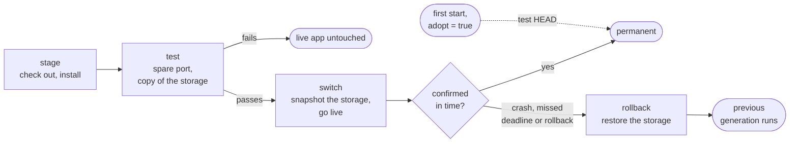

<p align="center">
  
</p>

<h1 align="center">Fawkes</h1>

<p align="center">A process supervisor for agents that upgrade themselves.</p>

Fawkes runs your app and turns every upgrade into a transaction. It builds the new version beside the running one,
tests it on a spare port, and switches over. If the new version does not confirm itself in time, Fawkes rolls code
and storage back.



> **Disclaimer.** Fawkes was built for [Ultimate](https://github.com/HazAT/ultimate), by Ultimate's agents. It is
> shared as is, and no support is planned.

## Install

You need Rust ([rustup](https://rustup.rs)) and `git`. Fawkes runs on macOS and Linux.

```sh
git clone https://github.com/shashito/fawkes.git
cd fawkes
cargo install --path . --locked
```

## Quickstart

### Ultimate

Stop the Ultimate of your project, then, in the `fawkes` folder:

```sh
node ultimate/fawkes/init.ts ~/Code/my-app
cd ~/Code/my-app && fawkes up
```

`~/Code/my-app` is your project's folder. Ultimate now upgrades through Fawkes.

### Any app

The sample app serves the text of its `VERSION` file and confirms itself once it is up. It needs Node.js 22.13 or
later. In the `fawkes` folder:

```sh
mkdir -p /tmp/demo/app
cp examples/sample/app.js examples/sample/hooks.js /tmp/demo/app/
cd /tmp/demo
echo v1 > app/VERSION
git -C app init -q && git -C app add . && git -C app commit -qm v1

cat > fawkes.toml <<'EOF'
name = "demo"
repo = "app"
home = "home"
port = 4790
start = "node app.js"

[hooks]
snapshot = "node hooks.js snapshot {home} {snapshot}"
restore = "node hooks.js restore {snapshot} {home}"
test_copy = "node hooks.js copy {home} {test_home}"

[env]
APP_PORT = "{port}"
APP_HOME = "{home}"
EOF
```

Run `fawkes up` in a second terminal in `/tmp/demo`, and keep it open. Then:

```sh
fawkes upgrade HEAD     # g1 goes live
fawkes wait g1          # g1 is permanent
curl localhost:4790     # v1

echo crash-live > app/MODE && git -C app add MODE && git -C app commit -qm broken
fawkes upgrade HEAD     # g2 passes its test, goes live and crashes
fawkes wait g2          # g2 was rolled back; g1 runs again
fawkes history

fawkes down
```

## Everyday commands

```sh
fawkes up                         # run the app under supervision, in the foreground
fawkes upgrade <ref>              # stage, test and switch in one call
fawkes wait [<gen>]               # wait until a generation is confirmed or rolled back
fawkes status                     # the app, its process and the pending switch
fawkes history                    # the generations
fawkes log --follow               # this app's events
fawkes watch                      # the events of every app
fawkes rollback                   # undo the pending switch now
fawkes start | stop | restart     # the app's process; Fawkes keeps running
fawkes down                       # stop the app and Fawkes
```

A command finds the app from the directory you run it in. Elsewhere, add `--manifest <name>`. Add `--json` for
output an agent can read, and run `fawkes skill` for the skill that teaches an agent the rest.

## Your own app

An app needs two things:

- **A manifest**, `fawkes.toml`: the repository, the start command, the port and, optionally, the storage hooks. The
  Quickstart's is a complete one; [`examples/sample/fawkes.toml`](examples/sample/fawkes.toml) shows more keys.
- **A confirm.** Once a new version works, it runs `"$FAWKES_BIN" confirm "$FAWKES_GENERATION"`, but only when
  `FAWKES_PHASE` is `live`. [`examples/sample/app.js`](examples/sample/app.js) shows how.

Without storage hooks, a rollback restores the code only.

## Ultimate in detail

`init.ts` sets up four things: a manifest in `~/.fawkes`, a link to the extension in the project, Ultimate's own
`update` turned off, and trust for the project's setup. Run it again and it changes nothing. On its first start,
Fawkes tests the Ultimate you were running and keeps it as the version to roll back to. Upgrades then run from the
`fawkes` item in Ultimate's status line. See [`ultimate/fawkes/README.md`](ultimate/fawkes/README.md).

## On a server

On a Mac that has to keep the app up without a terminal, let launchd run Fawkes. Run these in the app's folder:

```sh
fawkes service install      # start Fawkes now, at login and whenever it fails
fawkes service restart
fawkes service uninstall
```

Turn on SSH (Remote Login) as well. When the app is what broke, its own remote access may be broken too. macOS only;
see DESIGN.md → Service.

## How it works

An agent that edits its own code can break the code it runs from. A new version may go live before its dependencies
are installed, or fail to boot. Then nothing can bring the last good version back. launchd, supervisord and PM2
restart a crash, but they know nothing about versions.

Fawkes adds versions, called generations:

- **Stage:** a git worktree at a ref, with its dependencies installed.
- **Test:** the generation starts on a spare port with a copy of the storage and must pass a health check. A failed
  test changes nothing.
- **Switch:** Fawkes snapshots the storage, puts the new generation live and starts a deadline.
- **Confirm:** the new generation confirms itself. If it crashes first or misses the deadline, Fawkes restores the
  old code and the snapshot.

Fawkes never reads the storage. The app's own hooks copy, snapshot and restore it, and they always run from the last
good generation, never from the one under test.

The ideas are borrowed:

- **Generations** come from Erlang/OTP releases. A cold start always runs the last permanent generation.
- **Confirming itself** comes from RAUC and Mender A/B updates.
- **The deadline** comes from Junos `commit confirmed`.
- **No loops:** a generation rolls back at most once.

[DESIGN.md](DESIGN.md) is the full contract: manifest, CLI, socket protocol, files on disk and states.

## Status

A working prototype. Everything in DESIGN.md is built except its **Later** section. It has been tested on a copy of
Ultimate, never on a live install. The tests pass on macOS and Linux.

## Development

```sh
scripts/check           # cargo fmt, cargo deny, cargo clippy and cargo test, as every landing runs them
scripts/check --only X  # fmt, clippy and the one test X
```

`cargo deny` comes from `brew install cargo-deny`. The integration tests run the sample app, so they need `git` and
Node.js 22.13 or later. They run in parallel, each in its own `/tmp/fk<port>` with its own ports.
